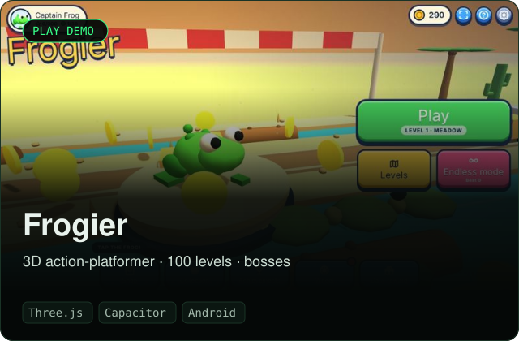
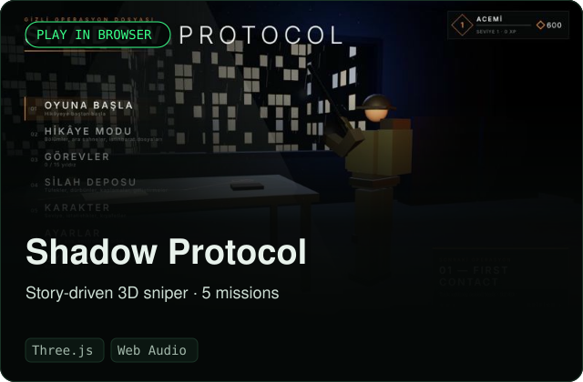
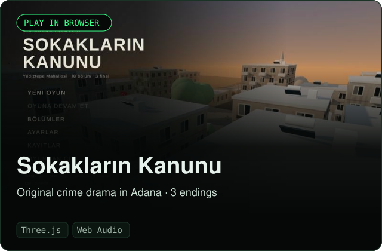
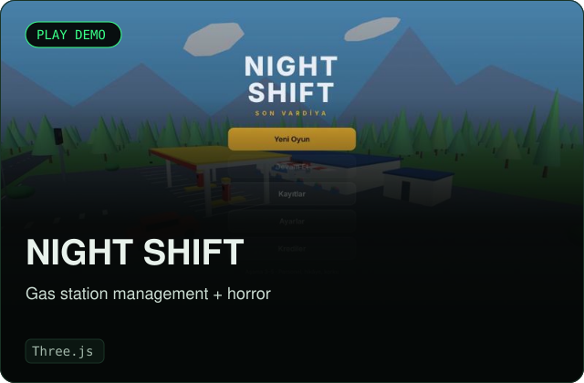
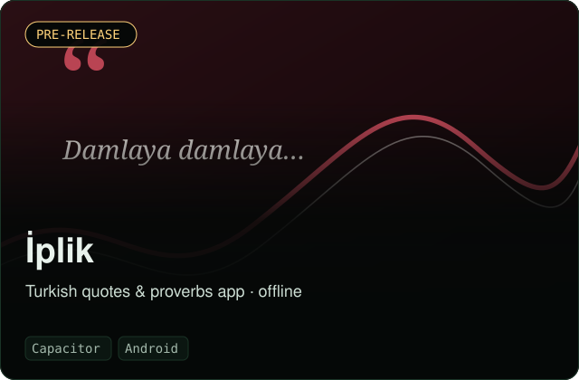
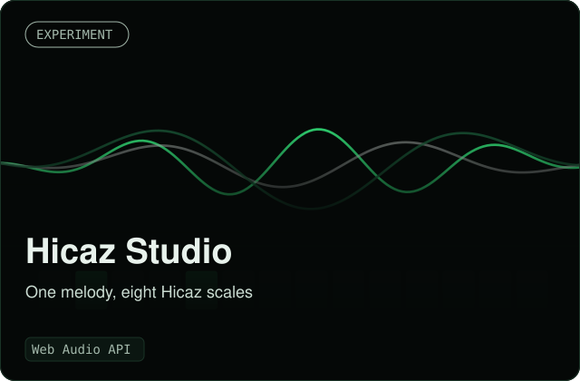
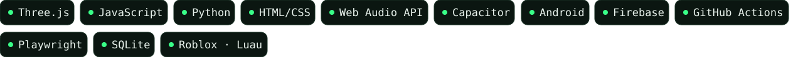

  <b>Berat Çetin</b> — Founder &amp; Independent Developer at Runia0 
  Software Development · Artificial Intelligence · Game Development · Digital Products

  <a href="https://runia0.github.io/runia0-site/"><b>🌐 Portfolio</b></a> &nbsp;·&nbsp;
  <a href="https://runia0.github.io/runia0-site/en/"><b>English</b></a> &nbsp;·&nbsp;
  <a href="https://runia0.github.io/runia0-site/projeler.html"><b>Projeler</b></a> &nbsp;·&nbsp;
  <a href="https://runia0.github.io/runia0-site/en/projects.html"><b>All projects</b></a>

## 🎮 Games

▶ <b>Play the demos in your browser:</b> <a href="https://runia0.github.io/runia0-site/play/frogie/">Frogier</a> · <a href="https://runia0.github.io/runia0-site/play/shadow-protocol/">Shadow Protocol</a> · <a href="https://runia0.github.io/runia0-site/play/sokaklarin-kanunu/">Sokakların Kanunu</a> · <a href="https://runia0.github.io/runia0-site/play/night-shift/">NIGHT SHIFT</a> · <a href="https://runia0.github.io/runia0-site/play/hicaz-studyosu/">Hicaz Studio</a>

<table>
  <tr>
    <td width="50%"></td>
    <td width="50%"></td>
  </tr>
  <tr>
    <td width="50%"></td>
    <td width="50%"></td>
  </tr>
</table>

## 🧩 Apps & experiments

<table>
  <tr>
    <td width="50%"></td>
    <td width="50%"></td>
  </tr>
</table>

<b>More projects</b> — tools, AI experiments and concepts

 

| Project | What it is | Status |
|---|---|---|
| [MATLAB Teaching Tool](https://runia0.github.io/runia0-site/en/projects/matlab-ogretim.html) | Teaches MATLAB basics with wrong vs. right examples | Working · private use |
| [Match Data Analysis Tool](https://runia0.github.io/runia0-site/en/projects/mac-analiz.html) | Desktop app for football match data | Prototype |
| [G-LINE AI](https://runia0.github.io/runia0-site/en/projects/g-line-ai.html) | Assistant combining several AI services and voice | Experiment |
| [Smart Home Assistant](https://runia0.github.io/runia0-site/en/projects/akilli-ev.html) | Home Assistant + AI on Raspberry Pi 5 | Prototype |
| [Create&Rate (Roblox)](https://runia0.github.io/runia0-site/en/projects/create-and-rate.html) | Gameplay scripting in a Roblox team project | In development |
| [runia0-site](https://github.com/Runia0/runia0-site) | This studio's portfolio — static, bilingual, no tracking | Live |

## 🛠️ Stack

## 🧭 How Runia0 works

**Idea → Prototype → Test → Release.** Ship something playable early, test it in a real browser, then package it for the store.
Runia0 openly uses AI as part of its development process; product decisions, design direction and quality control stay with the studio.

Every project is shown with its real status — no fake stats, no placeholder links.

